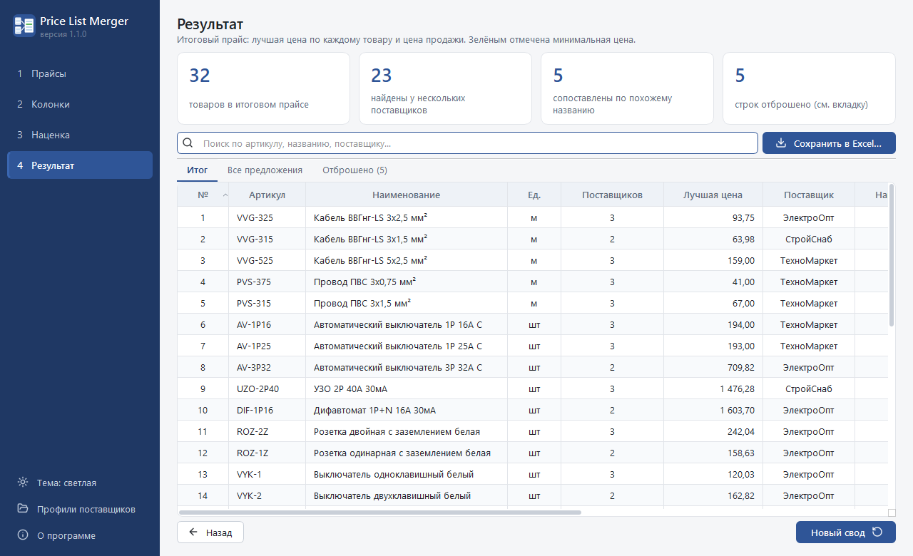
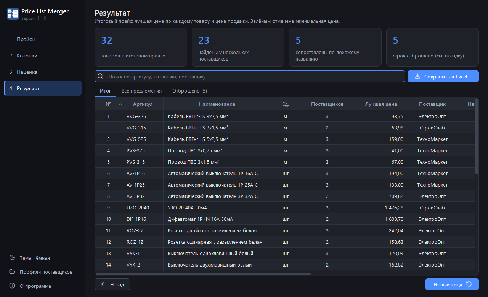
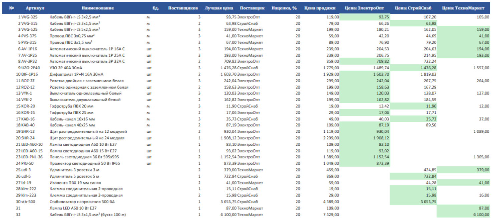
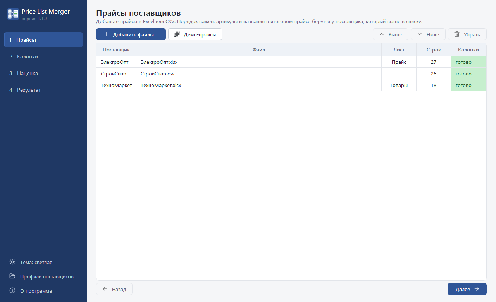
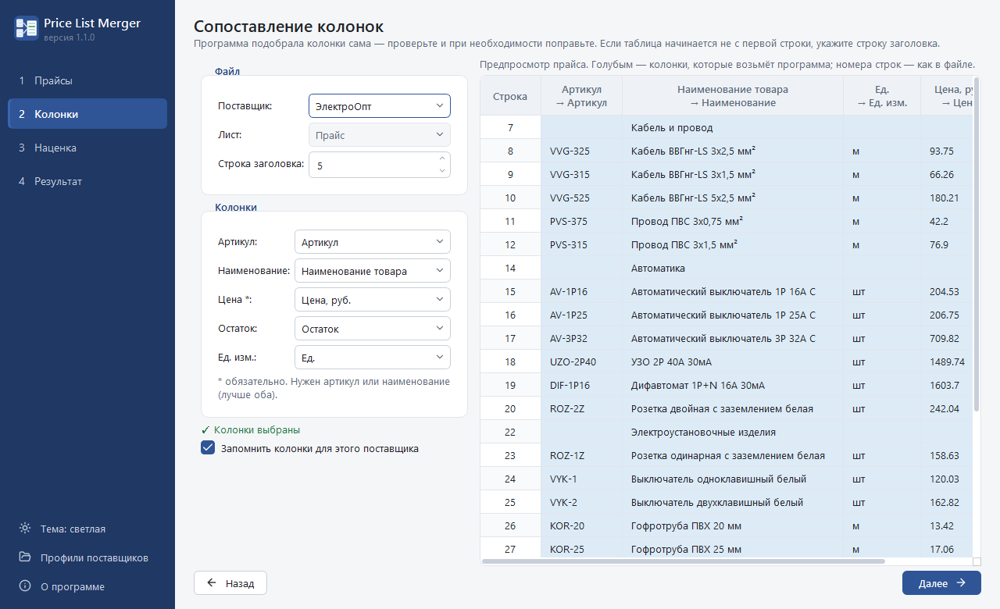
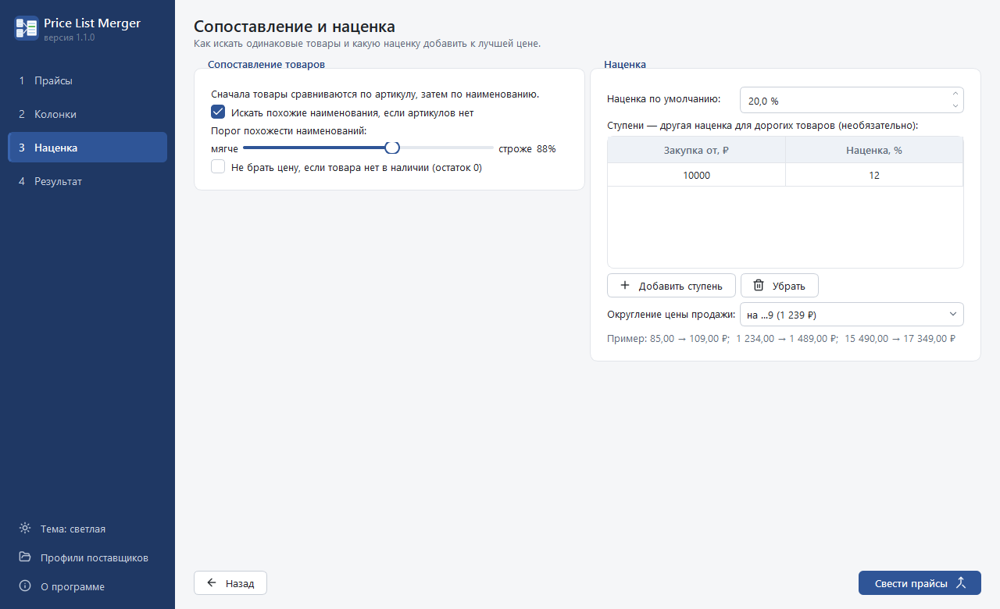
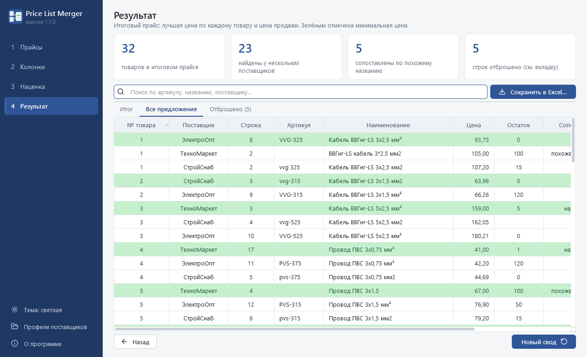

# Price List Merger

[](https://github.com/ZniKDK/price-list-merger/actions/workflows/tests.yml)
[](https://github.com/ZniKDK/price-list-merger/releases/latest)


Десктоп-программа для Windows, которая сводит прайс-листы нескольких поставщиков в один Excel.
Вы добавляете файлы в любом виде (Excel или CSV, разные колонки, шапка с логотипом, цены текстом),
программа находит одинаковые товары, выбирает минимальную цену и считает цену продажи с вашей наценкой.

| Светлая тема | Тёмная тема |
|---|---|
|  |  |

## Что умеет

- **Читает «грязные» прайсы.** Находит строку-заголовок под логотипом и названием фирмы, сама определяет
  кодировку CSV (UTF-8 или Windows-1251) и разделитель (`;`, `,`, табуляция). Если в книге несколько листов,
  выбирает лист с таблицей.
- **Подбирает колонки по заголовкам.** «Артикул», «Код товара», «Арт.»; «Цена, руб.», «Стоимость (₽)», «Опт».
  Выбор можно поправить и запомнить для поставщика: в следующий раз его прайс настроится сам.
- **Чистит данные.** Понимает цены вида `1 234,50 ₽`, `1.234,50`, `1,234.50`, пропускает «по запросу»,
  заголовки разделов и пустые строки. Из повторов товара внутри прайса оставляет меньшую цену.
- **Сопоставляет товары.** Сначала по артикулу (`AB-123` = `ab 123`, русские буквы-двойники вроде «А» и «В»
  тоже учитываются), затем по наименованию, затем по похожему наименованию: «Кабель ВВГнг 3х2,5 мм²»
  и «ВВГнг кабель 3*2.5 мм2» станут одним товаром. Товары с разными числами в названии
  («3х1,5» и «3х2,5») программа не склеит, даже если буквы совпадают.
- **Считает цену продажи.** Наценка общая или ступенями по закупочной цене, округление до рубля, до десятков
  или на «…9» (1 239 ₽). Можно не учитывать предложения с нулевым остатком.
- **Выгружает итоговый Excel.** Минимальная цена в строке подсвечена, шапка закреплена, есть фильтры,
  лист готов к печати.
- **Светлая и тёмная тема.** По умолчанию программа следует теме Windows и переключается вместе с ней.
  Тему можно выбрать вручную внизу боковой панели.
- **Работает из командной строки.** Свод можно запускать по расписанию через планировщик Windows.

## Итоговый файл

| Лист | Что внутри |
|---|---|
| Итог | Строка на товар: артикул, название, лучшая цена и поставщик, наценка, цена продажи, цены всех поставщиков |
| Все предложения | Каждая строка каждого прайса: с каким товаром сопоставлена и как (артикул, название, похожее название с процентом) |
| Не сопоставлено | Товары, которые нашлись только у одного поставщика |
| Отброшено | Строки, которые программа не взяла, с причиной и номером строки в исходном файле |
| Сводка | Цифры и настройки, с которыми сделан свод |



Пример результата: [docs/example/Свод прайсов (пример).xlsx](docs/example/Свод%20прайсов%20(пример).xlsx).

## Как пользоваться

| 1. Прайсы | 2. Колонки |
|---|---|
|  |  |
| **3. Наценка** | **4. Результат** |
|  |  |

1. Перетащите прайсы в окно или нажмите «Добавить файлы». Чтобы попробовать без своих файлов,
   нажмите «Демо-прайсы»: загрузятся три вымышленных поставщика с прайсами в разных форматах.
2. Проверьте колонки. Голубым в предпросмотре отмечены колонки, которые программа будет использовать.
3. Задайте наценку и округление. Ниже настроек программа покажет пример расчёта.
4. Нажмите «Свести прайсы», посмотрите результат и сохраните его в Excel.

Порядок поставщиков в списке важен: артикул, название и единицу измерения итоговый прайс берёт
у поставщика, который стоит выше.

## Установка

Скачайте файл со страницы [Releases](https://github.com/ZniKDK/price-list-merger/releases/latest):

- `PriceListMerger-<версия>-Setup.exe` — установщик. Права администратора не нужны, программа ставится
  в папку пользователя.
- `PriceListMerger-<версия>-portable.zip` — переносная версия: распакуйте и запустите `PriceListMerger.exe`.

Демо-прайсы лежат рядом с программой в папке `demo`.

Профили поставщиков хранятся в `%APPDATA%\PriceListMerger\profiles.json`. При удалении программы
они остаются на месте.

## Командная строка

```powershell
PriceListMerger-cli.exe demo\ЭлектроОпт.xlsx demo\СтройСнаб.csv demo\ТехноМаркет.xlsx `
    -o итог.xlsx --markup 20 --tier 10000:12 --round 9
```

| Параметр | Значение |
|---|---|
| `-o`, `--output` | итоговый файл (по умолчанию `свод_прайсов.xlsx`) |
| `--markup` | наценка по умолчанию, % |
| `--tier ЦЕНА:ПРОЦЕНТ` | ступень наценки, можно указать несколько раз |
| `--round` | `none` — до копеек, `1` — до рубля, `10` — до десятков, `9` — на «…9» |
| `--no-fuzzy` | не искать похожие наименования |
| `--threshold` | порог похожести 0–100 (по умолчанию 88) |
| `--skip-out-of-stock` | не брать цену при нулевом остатке |
| `--no-profiles` | не использовать профили, сохранённые в окне программы |

Из исходников консольная версия запускается так: `python -m price_list_merger.cli ...`

## Запуск из исходников

Нужен Python 3.11 или новее.

```powershell
git clone https://github.com/ZniKDK/price-list-merger.git
cd price-list-merger
python -m venv .venv
.venv\Scripts\activate
pip install -r requirements-dev.txt
pip install -e . --no-deps
python -m price_list_merger
```

Тесты (интерфейс проверяется без экрана):

```powershell
pytest
```

Сборка exe, переносного архива и установщика (для установщика нужен [Inno Setup 6](https://jrsoftware.org/isinfo.php)):

```powershell
.\build.ps1
```

Релиз собирает GitHub Actions: после отправки тега `v1.2.3` workflow прогоняет тесты, собирает файлы
и публикует релиз с описанием из `docs/releases/<тег>.md`.

## Стек

Python, PyQt6, pandas, openpyxl, rapidfuzz, pytest, PyInstaller, Inno Setup, GitHub Actions.
Версии зависимостей закреплены в `requirements.txt` и `requirements-dev.txt`.

## Структура проекта

```
src/price_list_merger/
├── core/            # логика без интерфейса
│   ├── loader.py    # чтение xlsx/csv, поиск заголовка, кодировка, разделитель
│   ├── mapping.py   # синонимы заголовков и автоподбор колонок
│   ├── cleaning.py  # разбор цен, нормализация артикулов и названий
│   ├── merging.py   # свод по артикулу, названию и похожему названию
│   ├── pricing.py   # наценка и округление
│   ├── pipeline.py  # весь процесс целиком
│   └── exporter.py  # итоговый Excel
├── gui/             # окно: мастер из четырёх шагов
├── profiles.py      # профили поставщиков (JSON)
├── cli.py           # командная строка
└── demo.py          # генератор демо-прайсов
tests/               # pytest
tools/               # иконка и скриншоты для README
installer/           # скрипт Inno Setup
```

## Лицензия

[MIT](LICENSE). Названия фирм и цены в демо-прайсах вымышлены.
